<h3>State Engineer in Computer Science | R&amp;D AI Software Engineer</h3>

<em>Building AI agents, RAG pipelines and semantic search into web &amp; mobile applications — with a strong focus on code quality, maintainability and scalability.</em>

  

  

### 🏦 AI Engineer & IT Support — Sopra Banking Software (SBS), Casablanca
`Final-year internship · Mar 2026 – Aug 2026`
- Member of the **Care First Line** team: end-to-end handling of tickets on the **Amplitude** core-banking solution — ErrLog analysis &amp; debugging, server testing via MobaXterm, end-of-day (TFJ) processing, SQL workaround scripts, fix follow-up to resolution.
- Designed **Smart Process**, an AI agent built on **Microsoft Copilot Studio** and powered by **Claude Sonnet 4.6**, using SharePoint &amp; Excel knowledge bases to automate L1/L2 ticket analysis.
- Automated business checks (priority, type, format, metadata, **GDPR compliance**) and generated structured responses (context, anomalies, alerts, draft customer reply) delivered in **Microsoft Teams**.
- **Human-in-the-Loop** validation before anything reaches the customer, with human feedback used to continuously improve prompts, relevance and reliability.
- 4GL · SQL · Oracle · Informix · Copilot Studio · Claude Sonnet 4.6 · Power Automate · EasyVista · SharePoint · Teams · GitLab

### 🤖 Backend &amp; AI Developer — OmniSoft, Paris
`Work-study internship · Mar 2025 – Jul 2025`
- Built a **RAG** solution for document search with REST APIs for ingestion, indexing and processing.
- NLP processing and **vector search** to improve result relevance; LLM API integration for contextual answers.
- Unit &amp; integration tests for API reliability; **Docker** containerization and test-environment deployments.

### 🧠 Web &amp; AI Developer — Mtech Technologies, Casablanca
`Final-year internship · Apr 2024 – Jul 2024`
- Designed a **RAG pipeline** with the OpenAI API and **LangChain** to answer questions over uploaded documents, with a **Streamlit** interface.
- Audio transcription with **OpenAI Whisper** and image understanding with **BLIP** (Hugging Face).

| Project | Description |
|---|---|
| 📚 **Document RAG Assistant — Java J2EE** | REST API + semantic search + LLM delivering contextualized answers over documents. |
| 🏨 **Hotel Booking System — Microservices** | Hotel reservation platform built on a microservices architecture. |

**🎓 Education** — State Engineering Degree in Computer Science, *Mundiapolis University, Casablanca* (2024 – 2026) · Bachelor's in Computer Science, *Mundiapolis University* (2022 – 2024)

<!-- SKILLS:START -->

<!-- SKILLS:END -->

 

<em>Let's connect and build something impactful.</em>

